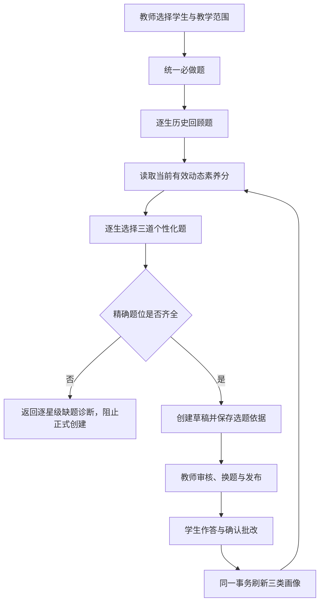

# 阶段三总体说明：画像、动态素养评分与个性化题目

整理日期：2026-11-07。

2026-11-11更新：正式目录、组卷筛选、动态评分、学生及班级雷达图统一为 HTML 的九项素养，评分版本为 `literacy-dynamic-v2`。第一步目录调整见[记录22](lin/22_九项正式素养目录统一记录.md)，完整切换、历史保护和验证见[记录23](lin/23_九维素养评分与组卷画像统一记录.md)。

2026-11-09维护更新：历史画像改为按发布快照归属知识点，统一学生列表与画像的有效证据统计，并新增按学生/班级/全部在读学生执行的三类画像重建入口。计算题080保留判分能力但退出日常自动组卷池。后续口径和验证见[记录21：画像证据、统计与重建维护](lin/21_画像证据统计与重建维护记录.md)。

本阶段在阶段二的必做题、历史回顾、知识点状态和周总结流程上，完成学生画像、班级学情、动态素养评分及个性化三题的业务接入，并补充证据一致性、试卷生命周期和换题审计。

本文依据本目录 `lin/01`～`lin/20` 共20份开发记录，以及仓库根目录的[《智能作业系统素养动态评分与个性化出题机制说明_修改版.docx》](../../智能作业系统素养动态评分与个性化出题机制说明_修改版.docx)整理。阶段三目录当前保存的是 Markdown 开发记录，DOCX 是机制需求来源。涉及先后调整的内容，以后续记录确认的口径为准；本文汇总阶段三成果，不代替运行环境的实时验收报告。

## 一、阶段目标与完成情况

本阶段建立了“确认作答 → 更新画像 → 按画像选题 → 冻结作业依据 → 新作答反馈”的闭环。

| 模块 | 阶段三最终实现 |
| --- | --- |
| 学生画像 | 按正式年级、章节和知识点展示正确率、知识点回顾标签及九维动态素养分，支持叠加班级平均 |
| 班级学情 | 展示全班知识点正确率、九维素养均值和作业进度；支持学生下钻 |
| 动态素养评分 | 从已确认、有效的发布试卷作答回放分数，支持持久化、改判重算和跨日维护 |
| 个性化选题 | 按所选主要素养的业务整数分确定基础星级，每名学生固定选择三道题 |
| 正式组卷 | 个性化题已接入统一预览、正式创建、草稿换题、发布及审计展示 |
| 一致性与优化 | 统一画像证据、连续错误链、试卷失效处理、换题历史及班级批量查询 |

早期记录中的“固定60分”“个性化算法后续接入”描述对应当时的过渡实现，后续已分别由动态评分和正式组卷链路替代。真实教学数据校准、高星题库覆盖和完整页面演示验收仍需继续推进。

## 二、整体业务流程



预览阶段只读取数据，不创建作业或试卷。正式创建时重新取分、重新选题，因此预览后发生改判或跨日回归时，正式结果可以与旧预览不同。创建后的选题依据固定保存，后续画像变化不会自动改写已创建作业。

## 三、画像展示与统计口径

### 3.1 学生画像

学生画像围绕三个结果展示：本章知识点正确率、知识点回顾标签、九维素养雷达图。历史作答页与画像共用年级、章节筛选；切换章节时清除原知识点条件并重置分页。

目录使用正式的“年级 → 章 → 节 → 知识点”关系，知识点按正式编码映射，节名称优先取题目主属节。活动章节下的全部正式知识点均需展示，即使该知识点暂时没有题目或有效作答。

知识点正确率采用：

```text
学生正确率 = 该学生该知识点有效确认答对次数 / 有效确认作答次数
班级正确率 = 全班该知识点有效确认答对总次数 / 有效确认作答总次数
```

班级正确率按作答总数汇总，不对学生个人正确率直接取平均。没有有效确认作答时，接口保留 `null`；图表可用灰色 `0%` 占位并说明“未评估”，该占位不计入统计分母。

### 3.2 九维素养与班级平均

正式素养维度为：**抽象能力、运算能力、几何直观、空间观念、推理能力、数据观念、模型观念、应用意识、创新意识**。

- 学生素养接口返回 `score_source=computed`、`rule_version=literacy-dynamic-v2`。
- 没有证据时返回九项60分，表示算法初始化结果，不是仍在使用旧的占位数据。
- 素养是跨章节的学生能力结果，不随知识点图表的年级、章节筛选重新定义。
- 班级素养分先对在读学生的内部小数求算术平均，再对均值取整；不先逐学生取整后求平均。
- 班级学情雷达图只绘制一条“班级平均”序列；学生画像可显示学生与班级平均两条序列。
- 班级平均请求失败时保留学生图，隐藏班级系列并提供重试；不能拿学生分数或零值代替班级数据。
- 学生与班级平均的素养名称或评分版本不一致时隐藏班级序列并提示重新加载，不把缺失维度补成0分。

知识点正确率、原有知识点掌握度和动态素养分是不同指标。动态素养分不会覆盖 `student_masteries` 的原有 EMA 语义。

### 3.3 知识点回顾标签

回顾标签以完整章节表格展示“本章知识点”“是否为否”“是否为弱”。无状态显示“未标记”，不能解释为“否”。

| 后端状态 | 是否为“否” | 是否为“弱” | 含义 |
| --- | --- | --- | --- |
| `yes` | 否 | 否 | 对应回顾流程已满足通过条件 |
| `no` | 是 | 否 | 有效来源错误之后，历史回顾再次确认错误 |
| `weak` | 是 | 是 | 在有效连续错误链基础上，周总结仍出现错误 |
| 无状态 | 未标记 | 未标记 | 尚未形成该状态的有效证据 |

“连续两次错误”需要完整审计链：来源和回顾作答属于同一学生、同一知识点；来源先发生、当前仍为确认错误且试卷有效；两次之间没有该知识点的确认正确作答；回顾本次也确认错误。不能仅凭 `source_module=history` 生成“否”。来源改判、来源版本失效或证据缺失后，应重放并撤销不再成立的标签；周总结“弱”也要验证其引用的完整错误链。

## 四、动态素养评分机制

### 4.1 参数与公式

| 参数 | 实现口径 |
| --- | --- |
| 初始分与范围 | 每名学生每种素养初始60分，范围0～100，初始答题次数0 |
| 星级难度值 `b` | 1～5星依次映射为30、45、60、75、90 |
| 平滑尺度 | 15 |
| 学习率 | `K = max(3, 12 / (1 + n / 30))`，`n` 为该素养累计答题次数 |
| 多素养权重 | 标签去重后，每种素养权重为 `1 / 关联素养数` |
| 日限幅 | 同一学生、同一上海自然日、同一素养净变化不超过±8分 |
| 未练回归 | 当日未练的素养向60分回归1% |
| 规则版本 | `literacy-dynamic-v2` |

设当前素养分为 `θ`，答对为 `r=1`、答错为 `r=0`，基础预期正确率及单题更新为：

```text
p = 1 / (1 + exp(-(θ - b) / 15))
θ_new = clamp(θ_old + K × w × (r - p), 0, 100)
```

选择题使用 `p_choice = g + (1-g) × p` 替代基础 `p`。优先按发布快照中的选项数取 `g=1/选项数`，缺少合法选项信息时回退到0.25。

回放按 `Asia/Shanghai` 自然日分组，同日按 `answered_at + attempt_id` 稳定排序。一天的题目处理完后，对练习过的素养执行日净变化限幅；未练素养执行：

```text
θ_next = θ + 0.01 × (60 - θ)
```

因此做对超出当前预期的题会增加更多分数，做错低于当前预期的题会扣除更多分数；答题次数增加后，单题影响逐渐减小。

### 4.2 精度与取整

内部计算保留小数，数据库 `score` 使用 `Numeric(7,4)` 保存四位小数。画像展示和个性化分档统一使用 `ROUND_HALF_UP` 得到业务整数，避免显示分数与选题星级不一致。

例如：内部59.49显示59并按1星处理；内部59.50显示60并按2星处理；内部89.50显示90并按5星处理。

### 4.3 有效证据与事务一致性

评分证据来自 `Attempt`、其当前 `AttemptRevision`、`Submission` 以及 `PaperInstanceItem` 发布快照。学生、提交、试卷和题项归属必须一致，试卷已发布且当前有效，作答状态为 `auto_confirmed` 或 `teacher_confirmed`，正误为明确布尔值。

阶段三素养回放校验发布快照中的选择、填空、判断题型、1～5星难度及合法九维素养标签。`needs_review` 不计入评分；非法或不一致证据使重建失败并回滚，不能静默生成结果。历史难度、题型、素养从发布快照读取，当前题库编辑不改变过去的评分语义。

`literacy-dynamic-v2` 不将旧“数据意识”映射为“数据观念”。存在这种有效历史证据时返回作答ID与复核原因并阻止重算；有实际作答次数、非60分或非空最后练习时间的旧维度物化记录也会被保留并阻止自动转换。仅在有效证据全部通过校验、旧维度完全是无证据初始化值时，才删除旧初始化行并从各自60分新建“空间观念”和“数据观念”。切换前可用 `scripts.transition_literacy_dimensions` 统一预演和导出审计报告。

人工提交、教师确认、修正答案、撤销确认、重新判分，以及图片作答经教师确认后，统一在同一事务刷新：

```text
StudentMastery → StudentLiteracyScore → StudentKnowledgeStatus
```

任一环节失败，业务写入和画像一起回滚。图片提取后仍待复核时不更新素养分；重复提交及无变化的重复处理不增加修订或重复刷新。

### 4.4 持久化与每日维护

阶段三通过 Alembic `0025` 新增 `student_literacy_scores`，每名学生每种素养一行，保存分数、答题次数、最后练习时间、计算截至日期和规则版本。无证据学生也可物化九条初始化记录；按相同证据与截止日期重复重建保持幂等。

GET画像保持只读：优先读取完整、同版本物化结果，并补算截至查询日的回归；记录缺失、规则版本不符或记录日期晚于查询日期时，回放有效证据。写回由启动检查和跨日后台维护承担，使用行锁、`skip_locked` 及保存点隔离，避免阻塞正在提交的学生或让单个异常影响全班。

## 五、个性化三题与正式组卷

### 5.1 教师范围及分档

教师选择年级、章节、知识点和一个主要素养。主要素养必须属于所选知识点配置的能力集合，候选题还必须同时满足：

```text
知识点 core_competencies 包含主要素养
且题目 core_literacy 包含主要素养
```

各学生在同一批次的同一个 `as_of` 时点读取有效分数，统一取整后确定三个题位：

| 业务整数分 | 基础星级 | 三道题目标星级 |
| --- | --- | --- |
| 0～59 | 1 | 1、2、3 |
| 60～69 | 2 | 2、3、4 |
| 70～79 | 3 | 3、4、5 |
| 80～89 | 4 | 4、5、5 |
| 90～100 | 5 | 5、5、5 |

“固定三星”在早期记录标题中指三个星级题位，不是三道题都为3星。即使三个题位均为5星，也必须选择三道不同题。

DOCX末尾示例表将90分列为4星，与其固定区间表冲突。开发记录和实现使用固定区间，因此90分对应5星，目标为5、5、5；不能沿用该冲突示例。

### 5.2 候选、去重和缺题

候选须在教师指定年级、章节、知识点范围内，未归档，且满足 `grading_readiness=machine_ready`、`source_review_status=reviewed` 和精确目标题星。统一按“必做题 → 历史回顾题 → 个性化题”选择，后面的模块排除当前学生卷内已选题。

初选和换题遵循 `avoid_recent_days`，默认排除近7天已经布置或作答的题，设置为0则关闭近期排除。班级批量生成优先分配本次使用次数少的题，再按原始题号、UUID稳定排序；跨学生可在库存不足时复用，但同一学生卷内不得重复。

预览返回逐星级候选数、可机判数、排除后的可用数、选中数、缺口及原因。班级复用是风险提示，不自动阻断；但任一学生个性化题不足三道，正式创建必须返回422，并在写入 `Assignment`、`PaperInstance` 前停止。不能通过跨知识点、跨素养、跨星级或重复用题静默补齐。

### 5.3 草稿、发布与换题审计

个性化三题为固定题位，只能按原范围、原主要素养、原精确星级换题，不能直接删除。发布前重新核对个性化题数量，普通总题量不足的确认不能绕过该约束；修订版同样适用。

每题通过 `source_module=personalized` 标识来源，并冻结主要素养、业务整数分、基础星级、完整目标序列、规则版本、生成时间及初始班级复用信息。预览不冻结，正式生成时才保存这些依据。

首次换题保存 `initial_selection`，之后逐次追加 `replacement_history`。初始生成依据保持不变，根级 `reason_text` 始终对应当前题目。页面分别展示初始依据、当前推荐理由和换题历史；“初始分配复用”“换题时复用”均为当时的快照，不表示实时人数。

## 六、试卷生命周期与查询优化

截至记录18在2026-11-07的调整，试卷只要当前或修订历史中曾出现确认批改结果，就不允许教师撤回。先撤销确认、再撤回也不能绕过限制；后端在事务内检查并返回409，拒绝时不改试卷、作答或画像。

尚未产生确认批改结果的已发布试卷可撤回、重新发布。新版发布后将旧版标记为“已被更新”属于版本替代；旧版作答退出当前画像，相关画像在发布事务中重放。失效记录仍保留用于历史查看和审计，批改详情与历史作答统一返回 `used_in_profile`。

班级画像通过 `load_contexts()` 批量加载学生、知识点、作答、当前修订、知识点状态和素养物化记录。物化记录不足时也批量查询回退证据，再按学生回放，避免逐学生查询。

## 七、开发过程与记录索引

| 记录 | 主要内容与衔接 |
| --- | --- |
| [01 基础画像展示调整](lin/01_基础画像展示调整记录.md) | 建立知识点正确率和八维雷达图，定义早期baseline合同，后续补充computed接入关联 |
| [02 年级章节筛选与知识点映射](lin/02_画像年级章节筛选与新知识点映射调整记录.md) | 统一正式年级、章节、节和知识点目录 |
| [03 实施拆解](lin/03_动态素养评分与个性化出题实施拆解.md) | 拆分算法、持久化、事务、画像、选题、正式接入和全链路验收 |
| [04 评分纯算法](lin/04_动态素养评分纯算法规则实现记录.md) | 固化评分公式、权重、日限幅、回归和星级规则 |
| [05 证据回放与持久化](lin/05_动态素养分证据回放与持久化实现记录.md) | 新增0025迁移、素养物化表及幂等重建命令 |
| [06 提交改判事务闭环](lin/06_动态素养分提交改判事务闭环实现记录.md) | 所有改变最终作答证据的入口统一刷新三类画像 |
| [07 动态分接入画像](lin/07_画像与班级学情动态素养分接入记录.md) | 学生与班级接口从baseline切换为computed |
| [08 取整、维护与标签准入](lin/08_动态素养分取整每日维护与题目标签准入记录.md) | 统一整数分档，增加跨日维护和题目素养校验 |
| [09 班级雷达图单序列](lin/09_班级学情素养雷达图单序列展示调整记录.md) | 消除班级页重复曲线和无意义切换 |
| [10 个性化纯选题](lin/10_个性化固定三星纯选题规则实现记录.md) | 固定三个精确星级题位，支持稳定排序、去重和缺题诊断 |
| [11 数据库候选与只读预览](lin/11_个性化数据库候选与只读预览实现记录.md) | 按教师范围取题，在统一时点读取学生有效整数分 |
| [12 正式创建接入](lin/12_个性化统一预览与正式创建接入记录.md) | 合并三类题目，创建时重算、缺题零写入阻断、保存审计 |
| [13 前端接入](lin/13_个性化作业前端接入记录.md) | 展示每生题位、缺口与冻结依据，移除未接入占位提示 |
| [14 约束、去重与风险提示](lin/14_个性化组卷约束去重与风险提示完善记录.md) | 双重素养匹配、固定题位、班级少复用、近期排除及换题诊断 |
| [15 完整章节正确率展示](lin/15_知识点正确率全章节展示修复记录.md) | 展示无题、无证据知识点，区分null与显示占位 |
| [16 画像与历史章节筛选统一](lin/16_学生画像与历史作答章节筛选统一记录.md) | 共享筛选状态，在分页前过滤历史作答 |
| [17 回顾标签表格化](lin/17_知识点回顾标签表格化记录.md) | 完整展示本章“否”“弱”和未标记状态 |
| [18 生命周期与画像证据](lin/18_失效试卷画像证据口径统一记录.md) | 统一失效证据过滤，并更新为已批改试卷不可撤回 |
| [19 连续错误与班级平均异常](lin/19_连续错误证据与班级平均异常展示修复记录.md) | 验证来源错误审计链，区分班级平均加载和失败状态 |
| [20 换题审计与批量查询](lin/20_个性化换题审计与班级画像批量查询优化记录.md) | 分离初始和当前选题依据，优化全班及冷缓存查询 |

## 八、主要实现入口

| 领域 | 主要文件 |
| --- | --- |
| 评分与标签 | [literacy_rules.py](../../backend/app/services/literacy_rules.py)、[literacy_catalog.py](../../backend/app/services/literacy_catalog.py) |
| 证据回放与统一刷新 | [literacy_scoring.py](../../backend/app/services/literacy_scoring.py)、[profile_refresh.py](../../backend/app/services/profile_refresh.py)、[knowledge_status.py](../../backend/app/services/knowledge_status.py) |
| 学生与班级画像 | [student_profile.py](../../backend/app/services/student_profile.py)、[class_analytics.py](../../backend/app/services/class_analytics.py) |
| 个性化选题及正式作业 | [personalized_selection.py](../../backend/app/services/personalized_selection.py)、[personalized_preview.py](../../backend/app/services/personalized_preview.py)、[paper_generation.py](../../backend/app/services/paper_generation.py)、[paper_workflow.py](../../backend/app/services/paper_workflow.py) |
| 后台维护与迁移 | [maintenance.py](../../backend/app/services/maintenance.py)、[0025迁移](../../backend/alembic/versions/0025_add_student_literacy_scores.py) |
| 前端展示与组卷 | [StudentDetailPage.tsx](../../frontend/src/pages/StudentDetailPage.tsx)、[ClassAnalyticsPage.tsx](../../frontend/src/pages/ClassAnalyticsPage.tsx)、[AssignmentCreatePage.tsx](../../frontend/src/pages/AssignmentCreatePage.tsx)、[PaperInstancePage.tsx](../../frontend/src/pages/PaperInstancePage.tsx) |

## 九、验证记录与后续事项

### 9.1 已记录的验证

开发记录覆盖纯算法边界、证据回放、改判与撤销、幂等和事务回滚、画像接口、选题缺口、正式创建阻断、连续错误来源、换题历史，以及班级批量查询等测试。各阶段全量测试数量逐步增加：

| 里程碑 | 记录中的后端全量测试结果 |
| --- | --- |
| 04 纯评分规则 | 142项通过 |
| 05～07 回放、事务与画像接入 | 147项通过 |
| 08 取整、维护与准入 | 151项通过 |
| 10 个性化纯选题 | 161项通过 |
| 11 数据库预览 | 166项通过 |
| 12 正式创建 | 169项通过 |
| 14 个性化约束完善 | 172项通过 |
| 15～16 展示与筛选修复 | 分别173项、174项通过 |
| 20 换题审计及批量查询 | 181项通过 |

这些数量是对应开发记录当时的结果，不能相加，也不是当前仓库重新测试所得。前端后续记录已包含类型检查和生产构建通过结果；09、13记录中的定向Playwright曾因容器缺少浏览器而未执行到页面，不能据此宣称阶段三全部页面验收完成。

复核时可从项目根目录执行以下命令。重建采用 `--dry-run` 仅预演，本次文档整理未执行数据重建或写库：

```powershell
docker compose exec -T backend pytest -q
docker compose exec -T frontend npm run typecheck
docker compose exec -T frontend npm run build
docker compose exec -T backend python -m scripts.rebuild_literacy_scores --all --dry-run
```

### 9.2 后续工作

1. **补足题库覆盖。** 重点检查各主要素养在精确知识点和高星级下的可机判题量，尤其4、5、5与5、5、5需要多道不同题的情形。候选不足是已显式诊断的库存问题，不能用降级补题掩盖。
2. **完成差异化页面验收。** 使用具有不同真实作答证据的5名Demo学生，覆盖预览、创建、换题、发布、提交、改判及画像更新；验证真实分数差异和正式作业差异，而非直接写死分数。
3. **补齐阶段三页面测试证据。** 按当前浏览器环境补跑画像、班级学情和个性化组卷相关用例，将历史环境阻塞与功能断言结果分别记录。
4. **使用真实数据校准。** 当前初始化、学习率、日限幅、平滑尺度和未练回归已形成明确规则，后续根据中学实际作答数据评估合理性；变更时保留规则版本和历史审计。
